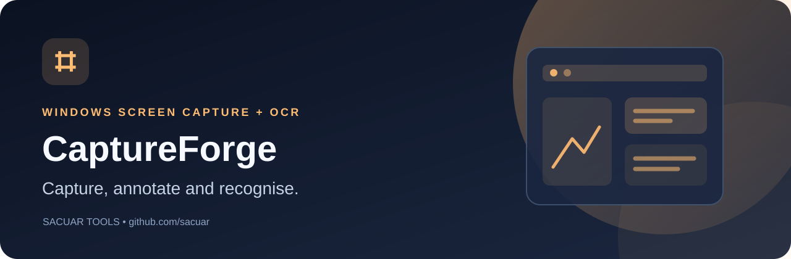

# CaptureForge

**A Windows capture workspace for screenshots, annotations and local text recognition.**

  

**[DOWNLOAD / RELEASES](https://github.com/sacuar/captureforge/releases)** · **[VIEW SOURCE](https://github.com/sacuar/captureforge)** · [More SACUAR apps](https://github.com/sacuar)

## Why use CaptureForge?

- Capture a region or monitor, then crop, rotate, annotate and save.
- Run local OCR with Tesseract or an available Windows OCR fallback.
- Work with desktop hotkeys, a tray launcher and compact editor controls.

## Install / try

Open **[GitHub Releases](https://github.com/sacuar/captureforge/releases)**, choose the latest suitable Windows asset, review its release notes and known limitations, and follow the installer instructions. If no verified installer is available, use the documented source-build instructions below. Download only from the official project release page.

**Development candidate:** Native C++/Qt Windows compilation, installer and OCR regression tests are not yet independently verified here. Review build results before installing; don't treat this page as a certified stable release.

**Licence:** No licence file was found in this audit. Public source visibility does not itself grant permission to redistribute or modify the code.

## Screenshots and first look

A verified screenshot or demonstration will be added after a successful Windows build. The banner above is branding artwork, **not** a screenshot of the application.

## Get involved

[Development notes](CHANGELOG.md) · [Report a bug](https://github.com/sacuar/captureforge/issues/new) · [Source code](https://github.com/sacuar/captureforge). Please report your Windows version, application version and steps to reproduce. Screenshots of reproducible issues help.

---

## Detailed documentation

## Features
Desktop launcher, region capture, multi-monitor selection, global hotkeys, floating camera button, system tray, image crop/pen/rotation/flip/undo, text editor, local OCR, configurable themes and trusted native add-ons. Tesseract is preferred; Windows OCR remains a fallback. Built-in OCR is processed off the UI thread. English is bundled; other language selection is not implemented.

## Install and updates
When a Windows build passes, the setup EXE is published at https://github.com/sacuar/captureforge/releases . Installer packages Qt and Tesseract, runs recognition on a generated test phrase, and reports failure. No Python or developer tools needed by end users. Updates are checked on startup (optional) or via tray menu, with release notes and SHA-256 verification before launching the installer with consent. Unsigned development binaries may trigger SmartScreen.

## Build
Install Visual Studio 2022 C++ workload, CMake, Qt 6.8.3 MSVC x64, vcpkg and Inno Setup 6. Set `QT_ROOT_DIR` to the Qt installation and `VCPKG_ROOT` to vcpkg. Run `BUILD_INSTALLER.bat`. The GitHub Actions workflow automates this and tests the installed executable. For local source development the older BUILD.bat remains available (without bundled OCR runtime). The dependency script downloads official Google Material Icons; if an individual icon is unavailable Qt provides a fallback.

## Add-ons
Tray > Add-ons > Manage add-ons. External DLLs are stored in the user app-data add-ons directory. Only load trusted DLLs compatible with the existing PluginInterface ABI; automatic loading is opt-in. Built-in Tesseract and Windows OCR work without third-party add-ons. Settings > OCR diagnostics tests the saved configuration. Add-on independent binary update catalogue is not yet implemented.

## Status
Source package prepared, Windows C++ compilation/installer/recognition tests not verified in this environment. Do not present as a certified or signed release. See THIRD_PARTY_NOTICES.md before distribution.

## Installation maintenance (1.0.1)
During setup, choose **Review previous builds → Scan and review old builds**. The same tool is installed in the Start menu as **CaptureForge maintenance**. Scan common locations, fixed drives or a specific folder; inspect registry entries and running copies. Recycle selected old files or compiled folders containing CaptureForge.exe, subject to safety checks. Installed locations, source projects and linked folders are protected; review contents first. Use Windows Installed apps to uninstall registered older versions. Stale per-user startup entries are backed up before removal. New CaptureForge launches reuse the existing session; legacy binaries may still run separately until removed. Tesseract retains its installation-time recognition test. No automatic deletion or registry sweeping.

## Compact interface (1.0.2)
Capture, OCR and Text editor are grouped in the launcher. Settings is alongside More (add-ons and updates). Editor toolbars use compact icons with tooltips by default. Right-click an editor toolbar and toggle **Show toolbar labels** to restore icon and text mode; the preference is remembered for new editor windows.
